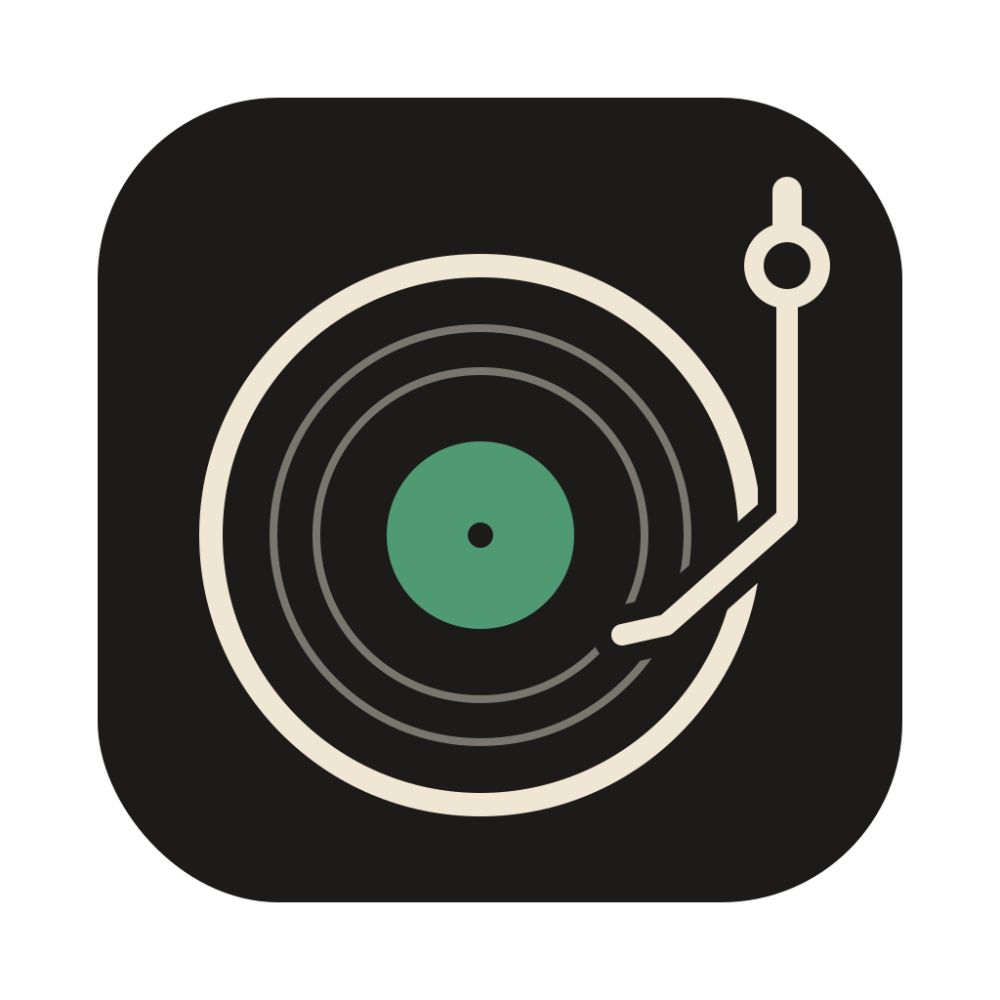
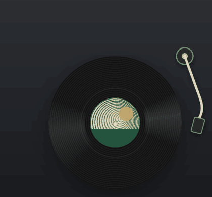

<p align="center">
  
</p>

<h1 align="center">Vinyl Corner</h1>

<p align="center">
  지금 듣는 노래를, 맥 화면 구석에서 도는 LP로.<br>
  <sub>A tiny spinning record for the corner of your Mac — shows what's playing in Spotify, Apple Music, or YouTube Music in your browser.</sub>
</p>

<p align="center">
  <a href="https://github.com/lingard09/vinyl-corner/releases/latest"><b>⬇ dmg 내려받기</b></a>
</p>

<p align="center">
  
</p>

## 이런 앱이에요

- 재생 중이면 판이 돌고, 톤암이 판 위로 내려옵니다
- 곡이 진행될수록 톤암이 판 **안쪽으로** 천천히 들어갑니다
- Spotify, Apple Music 앱은 물론 브라우저의 **유튜브 뮤직**도
- 가운데 라벨은 지금 곡의 **앨범 커버**
- LP에 마우스를 올리면 곡 제목, 클릭하면 재생/일시정지
- 화면 크기에 맞춰 LP 크기가 정해져요 (오른쪽 클릭 → 크기에서 직접 고를 수도)
- 오른쪽 클릭으로 속도(느긋하게 / 33⅓ / 45 RPM) 바꾸기, 끄기
- LP 바깥은 클릭이 뒤 창으로 그대로 통과해서 작업을 방해하지 않아요
- 아무것도 재생하지 않으면 조용히 숨어요

## 설치

1. [Releases](https://github.com/lingard09/vinyl-corner/releases/latest)에서 내 맥에 맞는 dmg를 받습니다
   (사과 메뉴 → 이 Mac에 관하여에서 "칩: Apple M…"이면 arm64, "프로세서: Intel…"이면 x64)
   - Apple 실리콘(M1 이후): `VinylCorner-x.y.z-arm64.dmg`
   - 인텔: `VinylCorner-x.y.z-x64.dmg`
2. dmg를 열고 Vinyl Corner를 응용 프로그램 폴더로 옮깁니다
3. 처음 열면 이런 경고가 뜹니다. 고장이나 악성 코드가 아니라, 애플 유료 인증(공증)을 받지 않은 개인 프로젝트라 한 번 거쳐야 해요
   > Apple could not verify "Vinyl Corner.app" is free of malware that may harm your Mac or compromise your privacy.
   >
   > (한국어 macOS에서는 "악성 코드가 없는지 확인할 수 없다"는 내용)

   - 경고 창은 **완료**를 눌러 닫습니다 (휴지통으로 옮기지 마세요)
   - **시스템 설정 → 개인정보 보호 및 보안**을 맨 아래까지 내려 **그래도 열기**를 누르고, 암호나 Touch ID로 허용합니다
   - "그래도 열기" 버튼은 앱을 열어 본 뒤 **약 한 시간 동안만** 보여요. 안 보이면 앱을 한 번 더 열고 다시 가보세요
   - 새 버전으로 덮어쓴 뒤에도 한 번 더 해야 할 수 있어요
   - 터미널이 편하다면: `xattr -dr com.apple.quarantine "/Applications/Vinyl Corner.app"`
4. Spotify·Music 앱을 쓴다면 "Vinyl Corner가 Spotify(Music)를 제어하려고 합니다"가 뜰 때 **허용**합니다.
   곡 정보를 읽는 데만 씁니다 (브라우저 재생은 이 권한이 필요 없어요)

> 권한을 거절했다면 시스템 설정 → 개인정보 보호 및 보안 → 자동화에서 다시 켤 수 있어요.

## 지원

| | |
| --- | --- |
| macOS | 12 Monterey 이상 (Apple 실리콘, 인텔) |
| 음악 앱 | Spotify 데스크톱 앱, Apple Music 앱 |
| 브라우저 | 유튜브 뮤직, 유튜브, 멜론 웹 등 제어 센터 "지금 재생 중"에 뜨는 재생 |
| 알려진 한계 | 파이어폭스 계열 브라우저(Floorp 등)는 커버를 넘겨주지 않을 때가 있어, 라벨에 제목 첫 글자가 대신 떠요 |

## 개인정보

Vinyl Corner는 아무 데이터도 수집하거나 보내지 않습니다.
밖으로 나가는 요청은 하나뿐이에요. Apple Music 곡처럼 커버를 받지 못한 곡의 앨범 커버를 찾으려고 **가수와 앨범 이름**으로 [iTunes 검색 API](https://performance-partners.apple.com/search-api)에 묻습니다.
Spotify 곡은 Spotify 앱이, 브라우저 곡은 브라우저가 알려주는 커버를 그대로 씁니다.

## 직접 빌드하기

```bash
git clone https://github.com/lingard09/vinyl-corner.git
cd vinyl-corner
npm install
npm run adapter    # 브라우저 재생 읽기용 (cmake 필요: brew install cmake). 건너뛰면 Spotify·Music만
npm start          # 바로 실행
npm run dist       # dist/ 에 dmg 만들기
```

## 어떻게 동작하나

| 파일 | 하는 일 |
| --- | --- |
| `src/main.js` | 화면 오른쪽 아래에 투명하고 항상 위에 있는 창을 띄우고, 1초마다 곡을 확인해 바뀌었을 때만 화면에 알립니다 |
| `src/nowplaying.js` | `osascript`(JavaScript for Automation)로 Spotify·Music 앱에 지금 곡과 재생 위치를 묻습니다 |
| `src/preload.js` | 화면에서 쓸 수 있는 기능만 골라서 열어줍니다 |
| `src/renderer/` | 판(CSS 동심원), 톤암(SVG), 곡이 바뀔 때 라벨 교체 |

| `src/system.js` | 브라우저 등 그 밖의 재생을 시스템 "지금 재생 중"에서 읽습니다 |

macOS 15.4부터 시스템의 "지금 재생 중" 기능(MediaRemote)을 일반 앱이 쓸 수 없게 막혔습니다.
그래서 Spotify·Music은 음악 앱에 직접 묻는 공식 방법을 쓰고, 브라우저 재생은
[mediaremote-adapter](https://github.com/ungive/mediaremote-adapter)(BSD-3)로 macOS 기본 perl을 거쳐 읽습니다.
이쪽은 애플이 다시 막을 수 있는 우회라서, 막히면 브라우저 재생만 안 보이고 Spotify·Music은 그대로 됩니다.

## 앞으로

- [ ] 앨범 커버 색으로 자동 컬러반
- [ ] 판 색 고르기 (블랙, 화이트, 마블)
- [x] 브라우저 재생 지원 (유튜브 뮤직 등)
- [ ] 실물 LP 연동: 슬리브의 NFC 태그를 폰으로 톡 → 지금 올린 판을 맥에도

아이디어나 버그는 [Issues](https://github.com/lingard09/vinyl-corner/issues)에 남겨 주세요.

## License

[MIT](LICENSE)
